# 🔗 Cyber Kill Chain Detection Lab

I simulated a harmless attack against my own PC, one Kill Chain stage at a time, and then hunted for each stage in Splunk using Sysmon logs. The result is an end-to-end attack timeline, an incident report, and an honest list of what my detections missed.

> **Author:** Niel | **Companion to:** Pyramid of Pain Detection Lab | **Tools:** Splunk Enterprise, Sysmon, Windows 11

## 🎯 Objective

Show how a single attack leaves traces at every stage, where a defender can break the chain, and where the logs have blind spots.

## 🧠 The Lockheed Martin Cyber Kill Chain

A framework that breaks an attack into seven stages. Stopping the attacker at any one stage breaks the chain.

| # | Stage | What the attacker does | Visible in my lab? |
| :---: | :--- | :--- | :---: |
| **1** | Reconnaissance | Researches the target | ❌ Happens outside the network |
| **2** | Weaponization | Builds the malicious file | ❌ Happens on the attacker's machine |
| **3** | Delivery | Sends the file to the victim | ✅ Simulated |
| **4** | Exploitation | The attacker's code runs | ✅ Simulated |
| **5** | Installation | Persists across restarts | ✅ Simulated |
| **6** | Command & Control | Malware contacts the attacker | ⚠️ Partially |
| **7** | Actions on Objectives | Attacker achieves their goal | ✅ Simulated |

> Stages 1 and 2 are invisible to defenders, which is why detection starts at Stage 3.

## 🛠️ Lab Setup

- Windows PC running Sysmon (logging process, network, file and registry activity) feeding Splunk Enterprise (index: `sysmon`).
- All tests use a dedicated folder, `C:\KillChainLab`.
- All tests were harmless simulations: no real malware, and nothing was sent off the machine. Everything was cleaned up afterwards.

---

## 🔍 Stage-by-Stage Results

### Stage 3: Delivery (MITRE ATT&CK: T1105, Ingress Tool Transfer)

- **Simulation:** PowerShell downloaded a harmless web page and saved it as `Invoice_Oct.ps1`, standing in for a malicious attachment arriving.

```splunk
index=sysmon EventCode=11 TargetFilename="*KillChainLab*"
| table _time Image TargetFilename
```

- **Result:** Sysmon logged `powershell.exe` creating `C:\KillChainLab\Invoice_Oct.ps1`. 
- ⚠️ **Gap found:** My first attempt, saved as `Invoice_Oct.txt`, was not logged. My Sysmon configuration only records certain file types. 
- **Pyramid of Pain:** Level 4 (host artifact)

| Command | Detection |
| :---: | :---: |
| 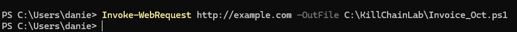 | 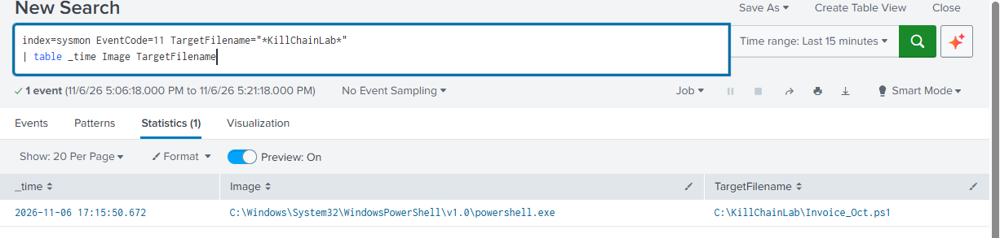 |

---

### Stage 4: Exploitation (T1059.001, PowerShell)

- **Simulation:** A PowerShell command ran another PowerShell with a harmless message. Office isn't installed in my lab, so this stands in for "a document launches PowerShell."

```splunk
index=sysmon EventCode=1 Image="*powershell.exe" CommandLine="*exploitation*"
| table _time ParentImage Image CommandLine
```

- **Result:** Sysmon logged the process start and the exact command line. *Note: The parent was `powershell.exe`. In a real attack the parent would be an Office program such as `winword.exe`, and that is the detection to build for production.*
- **Pyramid of Pain:** Level 6 (TTP)

| Command | Detection |
| :---: | :---: |
| 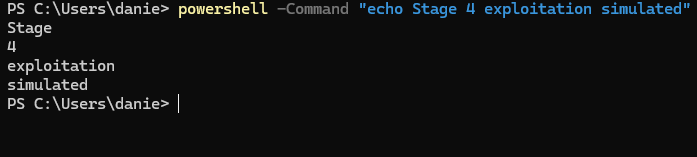 | 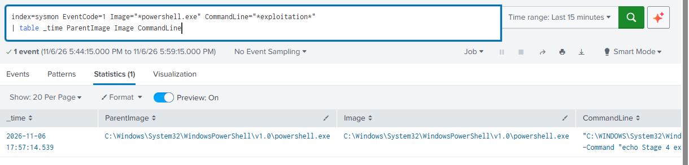 |

---

### Stage 5: Installation (T1547.001, Registry Run Keys)

- **Simulation:** I added a fake startup entry, `KillChainTest`, pointing to Notepad, then deleted it.

```splunk
index=sysmon EventCode=13 TargetObject="*Run\\KillChainTest*"
| table _time Image TargetObject Details
```

- **Result:** Sysmon logged `reg.exe` writing the new Run key value.
- **Pyramid of Pain:** Level 4 (host artifact)

| Command | Detection | Cleanup |
| :---: | :---: | :---: |
| 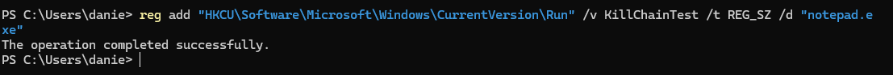 | 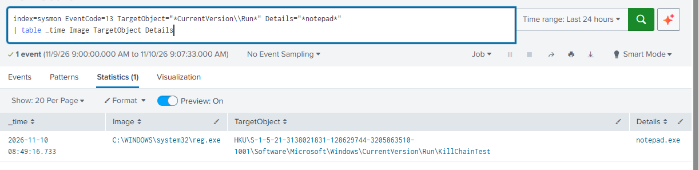 |  |

---

### Stage 6: Command & Control (T1071.001, Web Protocols)

- **Simulation:** PowerShell made web requests to a test site, mimicking malware calling home.

```splunk
index=sysmon EventCode=3 Image="*powershell.exe" DestinationPort=80
| table _time Image DestinationIp DestinationPort
```

- **Result:** Sysmon logged a connection from `powershell.exe` to `104.20.23.154` on port 80.
- ⚠️ **Gap found:** I ran a loop of six requests, but only one connection was logged. A likely cause is that PowerShell reused one connection, and Sysmon records new connections only. As a result I could not demonstrate real beaconing (regular repeated connections).
- **Pyramid of Pain:** Level 2 (IP address)

| Command | Detection |
| :---: | :---: |
| 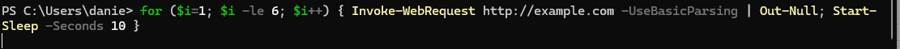 | 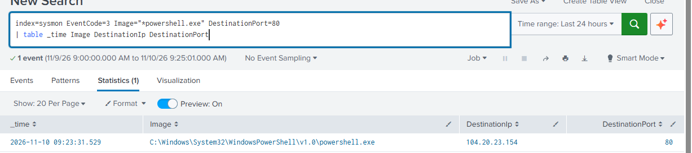 |

---

### Stage 7: Actions on Objectives (T1560.001, Archive via Utility)

- **Simulation:** I created two fake files (`passwords_fake.txt`, `customers_fake.txt`) and zipped them with `tar.exe`, as an attacker would before stealing data. Nothing was sent anywhere.

```splunk
index=sysmon EventCode=1 Image="*tar.exe" CommandLine="*KillChainLab*"
| table _time ParentImage Image CommandLine
```

- **Result:** Sysmon logged `tar.exe` creating `stolen_data.zip` from the fake files. 
- *Not simulated:* The exfiltration step itself (T1041).
- **Pyramid of Pain:** Level 5 (tool)

| Command | Detection |
| :---: | :---: |
| 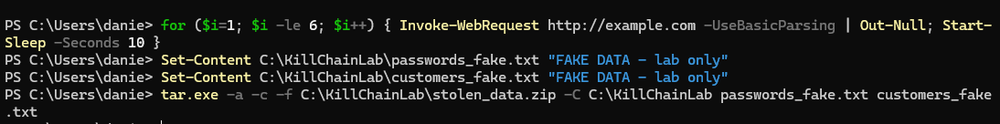 | 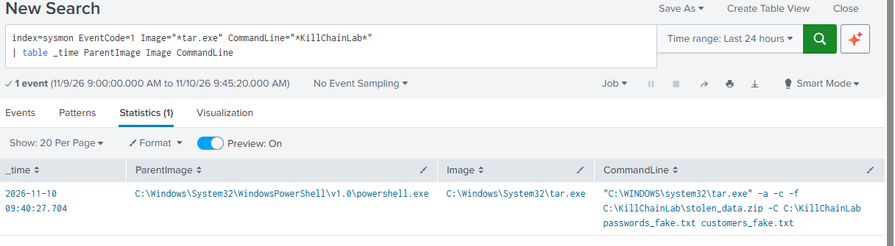 |

---

## ⏱️ Attack Timeline

One search that joins every stage in order:

```splunk
index=sysmon earliest="11/06/2026:17:00:00" ((EventCode=11 TargetFilename="*Invoice_Oct*") OR (EventCode=1 Image="*powershell.exe" CommandLine="*exploitation*") OR (EventCode=13 TargetObject="*Run\\KillChainTest*") OR (EventCode=3 Image="*powershell.exe" DestinationPort=80) OR (EventCode=1 Image="*tar.exe" CommandLine="*KillChainLab*"))
| eval Stage=case(EventCode=11,"3 Delivery", EventCode=1 AND like(Image,"%powershell.exe"),"4 Exploitation", EventCode=13,"5 Installation", EventCode=3,"6 Command and Control", EventCode=1 AND like(Image,"%tar.exe"),"7 Actions on Objectives")
| sort 0 _time
| table _time Stage Image CommandLine TargetFilename DestinationIp
```

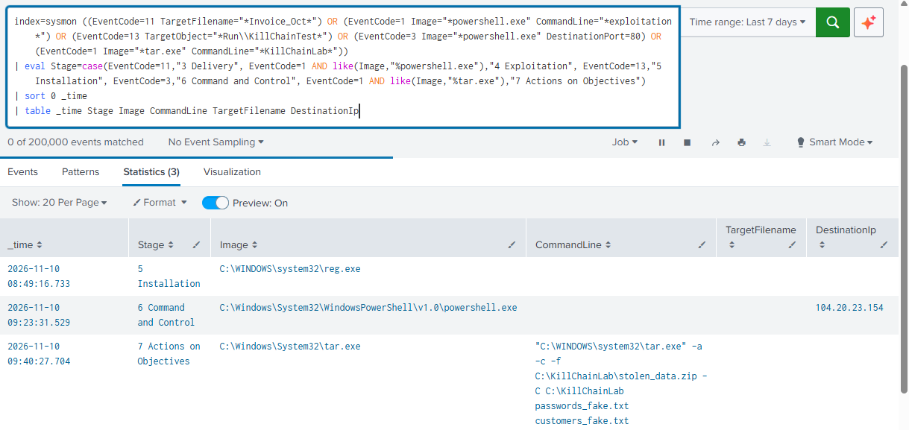

> The stages ran across several sessions. In a real attack they would be minutes apart.

---

## 🛡️ Where Could a Defender Break the Chain?

| Stage | Detect | Deny / Disrupt |
| :--- | :--- | :--- |
| **3 Delivery** | Alert on script files created in unusual folders | Block risky attachments at the email gateway |
| **4 Exploitation** | Office spawning PowerShell/cmd | Disable Office macros from the internet |
| **5 Installation** | New Run key entries | Restrict who can write to startup locations |
| **6 C&C** | Repeated connections to rare destinations | DNS/web filtering, egress rules |
| **7 Objectives** | Archive tools run on sensitive folders | Data loss prevention, file access controls |

---

## 🕳️ Gaps and Limitations

- Stages 1–2 are invisible from inside the network.
- `.txt` file delivery was not logged, so my Sysmon config missed it.
- Beaconing was not captured. Only one connection was recorded for six requests.
- Exploitation used PowerShell as the parent, because Office isn't installed.
- Process-access logging (Event ID 10) is off, so credential theft detections (Pyramid Level 5) can't be tested.
- Exfiltration was not simulated.

---

## 💡 Key Takeaways

- An attack leaves a trail at every stage, but only where logging is configured to record it.
- Breaking the chain early (Delivery, Exploitation) costs the attacker more than catching them at the end.
- Several of my detections failed on the first try, and each failure showed a logging gap I can now fix.
- Seeing an attack as a chain changed how I think about detection. One alert tells you very little, but five small events lined up in order tell a story. I also learned that a detection is only as good as the logs behind it.

---

## 🔭 Next Steps

- [ ] Update the Sysmon config to log more file types
- [ ] Repeat Stage 4 with Office installed
- [ ] Build a Splunk dashboard and a beaconing alert
- [ ] Write Sigma rules for the Stage 4 and 5 detections

---

## 📚 References

- Lockheed Martin, *Cyber Kill Chain*
- [MITRE ATT&CK](https://attack.mitre.org)
- TryHackMe SOC Level 1 learning path
